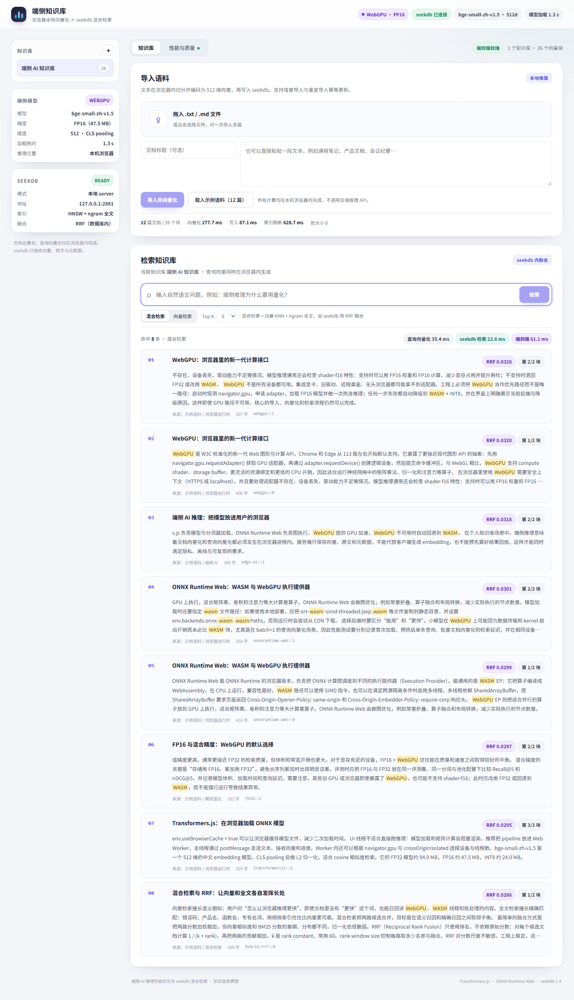

# 端侧知识库 · 浏览器本地向量化 × seekdb 混合检索

> 阶跃星辰赛题「端侧 AI 推理性能优化与 seekdb 混合检索」参赛作品。
> 文档与查询的 embedding 全部在浏览器内完成；向量、原文与元数据写入本地 seekdb；
> 向量 + 全文混合检索在 seekdb 内部用 RRF 完成。



## 1. 这是什么

一个可以直接在 Chrome / Edge 中运行的迷你个人知识库：

1. 拖入 `.txt` / `.md` 文档，或载入内置的 12 篇中文示例语料；
2. 浏览器内的 Web Worker 加载 `bge-small-zh-v1.5`，把文档切成 420 字左右的块并编码为 512 维向量；
3. 向量、原文和元数据通过 seekdb-js 写入本地 seekdb 的 collection；
4. 输入自然语言问题，查询同样在本地编码，seekdb 用「HNSW 向量 KNN + ngram 全文」两路召回并在数据库内做 RRF 融合；
5. 展示排序后的原文片段、来源、块序号与分阶段延迟。

界面会明确显示当前推理后端（WebGPU + FP16 / WASM + INT8）、模型加载耗时、seekdb 连接状态，以及每次导入/检索的分阶段耗时。

## 2. 题目要求对照

| 要求 | 实现 |
|---|---|
| 完整流程：导入 → 本地向量化 → 写入 seekdb → 混合检索 | `web/` 负责切分与推理，`server/` 通过 seekdb-js 写入/检索 |
| 文档与查询 embedding 均在浏览器本地 | Transformers.js + ONNX Runtime Web 运行在 Web Worker；无云端推理 API |
| INT8 / FP16 量化，报告体积、压缩比、质量变化 | FP16 47.5 MB（2.00×）、INT8 24.0 MB（3.95×）；Recall@5 / nDCG@5 见第 6 节 |
| 优先 WebGPU，不支持时自动降级 WASM 并提示 | Worker 先尝试 WebGPU + FP16，失败自动回退 WASM + INT8，界面显示原因 |
| 通过 seekdb-js 接入，创建集合并保存向量/原文/元数据 | `server/store.mjs`，collection 含 id/document/embedding/metadata |
| 向量 + 全文混合检索由数据库完成 | `collection.hybridSearch({ query, knn, rank:{rrf} })`，客户端不拼合两路结果 |
| 增量写入与索引刷新 | 稳定块 ID + `upsert`，批量写入后统一 `refresh_index()` |
| 集合与会话状态 | 侧边栏切换知识库，collection ID 持久化在 localStorage，检索始终显式带 ID |
| 基础性能优化与前后实测 | 批处理、模型缓存、Worker、单次刷新、WASM 多线程；见第 6 节 |
| 可运行 Web 应用 + 源码 + 一页技术说明 | 本仓库；[TECH_NOTE.md](TECH_NOTE.md)；[bench/](bench/) 原始数据 |

## 3. 快速开始

### 环境

- Node.js **22+**（`@oceanbase/seekdb-node` 要求 Node 22/24）
- Windows x64 / Linux x64 / Linux arm64 / macOS arm64 之一
- 至少 **3 GB** 可用磁盘（seekdb 默认 `log_disk_size=2G` + `datafile_size=256M`）
- Chrome / Edge 最新版；WebGPU 可用时走 GPU，否则自动用 WASM

### 启动

```bash
cd stepfun
npm install          # 会安装 seekdb 平台运行时，并复制 ORT WASM 到 web/public/ort
npm run dev          # API: 8787, Vite: 5173
```

打开 <http://127.0.0.1:5173>。

- **首次启动**会在 `.data/seekdb` 初始化本地 seekdb，约 1-3 分钟；页面顶部会显示「正在启动本地 seekdb」。
- 之后启动会复用同一数据目录，通常数秒内就绪。
- 首次使用点击「载入示例语料（12 篇）」，等待导入完成即可检索。

生产模式（同一个 Node 进程托管前端与 API）：

```bash
npm run build
npm start            # http://127.0.0.1:8787
```

### 常用环境变量

| 变量 | 默认 | 说明 |
|---|---|---|
| `PORT` | `8787` | Web/API 端口 |
| `SEEKDB_PORT` | `2881` | 本地 seekdb TCP 端口；被占用时自动尝试 2882-2885 |
| `SEEKDB_DATA_DIR` | `.data/seekdb` | seekdb 数据目录 |
| `SEEKDB_STARTUP_TIMEOUT` | `300000` | 首次启动等待毫秒数 |

### 如果 `npm install` 跳过了 postinstall

```bash
npm run prepare:ort   # 复制 ONNX Runtime WASM 到 web/public/ort
npm run fetch:models  # 仅在模型文件缺失时需要（默认已随仓库提供）
```

> `.npmrc` 中启用了 `legacy-peer-deps`，用于绕过 `seekdb@1.4.0` 可选 peer `@seekdb/default-embed` 的 `workspace:*` 发布问题。

## 4. 架构

```text
┌──────────────────────────── Browser (本机) ────────────────────────────┐
│  React UI                                                              │
│    │ 文本/文件                                                           │
│    ▼                                                                    │
│  Web Worker ── AutoTokenizer + AutoModel（Transformers.js）              │
│    │            ├─ WebGPU + FP16（优先）                                  │
│    │            └─ WASM  + INT8（自动降级，4 threads）                     │
│    │ 512d 向量                                                           │
│    ▼                                                                    │
│  fetch('/api/...')                                                      │
└───────────────────────────────┬────────────────────────────────────────┘
                                │ HTTP (127.0.0.1:8787)
┌───────────────────────────────▼────────────────────────────────────────┐
│  Node API (Express)                                                    │
│    ├─ /api/collections/:id/import  → seekdb-js upsert + refresh_index   │
│    └─ /api/collections/:id/search  → collection.hybridSearch(RRF)       │
│                                │                                       │
│  seekdb local server (spawned)  │  MySQL protocol :2881                │
│    ├─ HNSW 向量索引（cosine, 512d）                                     │
│    ├─ ngram 全文索引（ngram_token_size=2）                              │
│    └─ DBMS_HYBRID_SEARCH：两路召回 + RRF 融合（数据库内完成）             │
└────────────────────────────────────────────────────────────────────────┘
```

### 为什么用「本地 server 模式」而不是 in-process embedded

seekdb-js 的 embedded 绑定在 Windows 上依赖命名管道，当前版本在部分 Windows 环境会卡在 `open()` 的 readiness 检测。项目改用官方 `@oceanbase/seekdb-node` 附带的 `seekdb` 可执行文件，显式以 TCP 方式启动本地 server（`mysql_port_mode=specified`），再用 seekdb-js 通过 MySQL 协议连接：

- 跨 Windows / Linux / macOS 行为一致；
- 数据仍然完全落在本机 `.data/seekdb`；
- 满足题目「嵌入式或本地 server 方式部署」的要求；
- 启动、连接、健康检查都可由应用自动完成，无需用户手工起数据库。

## 5. 端侧推理与量化

### 模型

| 项 | 值 |
|---|---|
| 模型 | `Xenova/bge-small-zh-v1.5`（BAAI `bge-small-zh-v1.5` 的 ONNX 转换） |
| 来源 | <https://huggingface.co/Xenova/bge-small-zh-v1.5>（仓库内已带模型文件） |
| 维度 / 池化 | 512 / CLS + L2 normalize |
| 运行时 | Transformers.js 4.3.2 + ONNX Runtime Web |
| 文件校验 | [bench/model-manifest.json](bench/model-manifest.json)（大小 + SHA-256） |

### 量化与后端

| 配置 | 文件 | 体积 | 压缩比 | 用途 |
|---|---|---:|---:|---|
| FP32 基线 | `onnx/model.onnx` | 94,851,877 B（90.5 MiB） | 1.00× | 质量基线（不随仓库提交，`npm run fetch:fp32` 获取） |
| FP16 | `onnx/model_fp16.onnx` | 47,497,427 B（45.3 MiB） | 2.00× | WebGPU 优先路径 |
| INT8 | `onnx/model_quantized.onnx` | 24,010,842 B（22.9 MiB） | 3.95× | WASM 降级路径 |

FP16 通过 ONNX FP16 转换得到；INT8 使用模型仓库提供的 `model_quantized.onnx`。量化前后的检索质量与体积变化均为实测，不是估算。

### 后端选择

Worker 启动时：

1. 若 `navigator.gpu` 存在，申请 adapter 并加载 FP16 模型；
2. 用一条 `warmup` 文本做真实推理，确认 GPU 路径不是“能创建 session 但不能算”；
3. 任一步失败 → 记录原因 → 释放模型 → 加载 WASM + INT8；
4. 页面顶部与侧边栏显示最终后端、精度与降级原因。

WASM 路径在 `crossOriginIsolated` 为真时启用 4 线程；开发服务器与生产服务器都设置了 COOP/COEP 响应头。ONNX Runtime 的 WASM 文件由 `scripts/prepare-ort.mjs` 复制到 `web/public/ort/`，运行时不依赖 CDN。

### 量化质量

评测集：24 条中文查询，覆盖精确词、语义、跨文档与配置类问题；语料切分为 26 个块。对每个文档取最高分块排序，计算文档级 Recall@5 / nDCG@5。

| 模型 | 体积 | 压缩比 | Recall@5 | nDCG@5 | 相对 FP32 |
|---|---:|---:|---:|---:|---:|
| FP32 | 90.5 MB | 1.00× | 0.9653 | 0.9012 | 基线 |
| FP16 | 45.3 MB | 2.00× | 0.9653 | 0.9012 | 0.00 pp |
| INT8 | 22.9 MB | 3.95× | 0.9444 | 0.8999 | Recall −2.08 pp / nDCG −0.13 pp |

详细数据与复现命令见 [bench/quality.json](bench/quality.json) 和 `npm run eval:quality`。

> 说明：该评测刻意使用**纯向量 cosine 召回**来隔离量化对 embedding 的影响；线上混合检索还包含全文分支，两路 RRF 融合后对量化误差有一定补偿。评测方法与线上使用同一份 `chunkText`、同一 tokenizer、同一模型文件。

## 6. 性能实测

测试设备：Windows 11，32 逻辑核 / 32 GB 内存，Microsoft Edge 156（headless），seekdb 1.4.0。语料 12 篇 / 26 块，查询集取 `data/eval.json` 前 8 条，重复 3-5 轮取中位数。

### 分阶段结果

| 阶段 | WebGPU + FP16 | WASM + INT8 |
|---|---:|---:|
| 模型加载（含 tokenizer + 热身） | 1.33 s | 0.66 s |
| 文档向量化（26 块，batch=8） | 277.7 ms（93.6 块/s） | 1064.7 ms（24.4 块/s） |
| 写入 seekdb（26 条，batch=32） | 87.1 ms | 137.5 ms |
| 索引刷新 `refresh_index()` | 628.7 ms | 663.2 ms |
| 查询向量化（batch=1，中位数） | 10.40 ms | 5.95 ms |
| seekdb 混合检索（中位数） | 5.38 ms | 8.80 ms |
| **端到端查询（中位数）** | **18.15 ms** | **20.01 ms** |
| 端到端 P95 | 21.19 ms | 23.00 ms |
| 首次查询（导入后冷启动） | 60.5 ms | 39.2 ms |

原始记录：[bench/browser-webgpu-fp16.json](bench/browser-webgpu-fp16.json)、[bench/browser-wasm-auto-fallback.json](bench/browser-wasm-auto-fallback.json)、[bench/summary.json](bench/summary.json)。

### 结论

- **WebGPU 的主要收益在批量文档向量化**：26 个块从 1065 ms 降到 278 ms，约 **3.8×**；这直接改善首次导入体验。
- **batch=1 的查询向量化，WASM + INT8 并不比 WebGPU + FP16 慢**；小模型单条推理的 GPU 调度与传输开销占主导。因此查询路径的优化重点不是盲目切 GPU，而是模型缓存、Worker 预热、限制 batch=1、把检索下推到数据库。
- 端到端查询在两种后端下都约 **19-20 ms**，其中 seekdb 检索只占约 5-9 ms；主要成本是浏览器内 embedding 与进程间 HTTP。
- 首次导入后的第一次查询有 60-83 ms 冷启动（HNSW/缓存），预热后稳定在 20 ms 左右；报告中区分了这两个口径。

### 已实施的优化

1. **批量 embedding**：导入时 batch=8，摊薄 ONNX kernel 启动开销；查询固定 batch=1，避免为单条查询制造额外 padding。
2. **模型本地化 + 浏览器缓存**：`allowRemoteModels=false`，模型文件随仓库提供；`useBrowserCache=true`。
3. **Web Worker**：推理不阻塞 UI；加载进度、推理进度通过消息回传。
4. **单次索引刷新**：批量 upsert 后只调用一次 `refresh_index()`，而不是每写一条刷新。
5. **写入批处理**：26 条向量按 32 条一批写入，减少 HTTP/事务往返。
6. **数据库内 RRF**：混合检索只发一次请求，不在客户端分别取两路再拼合。
7. **WASM 多线程**：COOP/COEP + `crossOriginIsolated` 时启用 4 线程。
8. **可观测性**：内置性能面板，分别记录模型加载、文档向量化、写入、刷新、查询向量化、seekdb 检索与端到端延迟，并输出 P50/P95。

## 7. 复现与评测

```bash
# 1. 质量评测（Node CPU，FP32/FP16/INT8；需要 FP32 文件）
npm run fetch:fp32
npm run eval:quality        # 生成 bench/quality.json

# 2. 浏览器端到端基准（需要先 npm run dev）
npm run bench:browser -- --backend=webgpu --rounds=3
npm run bench:browser -- --hide-gpu=true --rounds=3   # 关闭 WebGPU，验证自动降级

# 3. 模型清单
node scripts/model-manifest.mjs
```

- 评测语料与查询集：[data/corpus.json](data/corpus.json)、[data/eval.json](data/eval.json)
- 切分逻辑（浏览器 / Node 共用）：[shared/text.mjs](shared/text.mjs)
- 质量评测脚本：[scripts/eval-quality.mjs](scripts/eval-quality.mjs)
- 浏览器基准脚本：[scripts/bench-browser.mjs](scripts/bench-browser.mjs)

## 8. 目录

```text
stepfun/
├── server/                 # Express API + seekdb 生命周期 + collection 封装
│   ├── index.mjs
│   ├── seekdb-service.mjs  # 定位平台运行时、启动/复用 seekdb、健康检查
│   └── store.mjs           # upsert、refresh、hybridSearch、collection 列表
├── web/
│   ├── src/
│   │   ├── App.jsx
│   │   ├── embedder.worker.js   # WebGPU/WASM 推理与自动降级
│   │   ├── components/
│   │   └── lib/
│   ├── public/models/      # FP16 + INT8 模型、tokenizer
│   └── public/ort/         # npm install 时复制，运行时本地加载
├── shared/text.mjs         # 切分 / 稳定 ID（前后端与评测共用）
├── data/                   # 示例语料、评测集
├── bench/                  # 质量、性能原始数据与模型清单
├── docs/                   # 截图
├── scripts/                # 模型下载、ORT 准备、质量评测、浏览器基准
├── TECH_NOTE.md            # 一页技术说明
└── README.md
```

## 9. 已知限制

- 首次启动 seekdb 需要初始化 2 GB redo + 256 MB datafile，耗时 1-3 分钟；磁盘不足 3 GB 会启动失败，日志在 `.data/seekdb/log/seekdb.log`。
- 测试使用 headless Edge 的 WebGPU 实现，数值不代表独立显卡；不同 GPU/驱动下 WebGPU 与 WASM 的相对性能可能变化。
- 语料规模为 12 篇 / 26 块，未做大规划 ANN 压测；HNSW 参数使用默认值，未针对大规模数据调优。
- seekdb-js 1.4.0 的 `listCollections()` 在当前 server 版本上返回空数组，项目通过查询 `sdk_collections` 元数据表绕过；升级 SDK 后可移除该兼容逻辑。
- 当前仅支持文本；图片内容支持是题目可选项，未纳入本次实现。
- `npm install` 会下载约 120-330 MB 的 seekdb 平台运行时，首次安装较慢。

## 10. 提交信息

- 基础分支：`2026-competition-ecosystem`（`oceanbase/powercontext`）
- 提交仓库：`jianjking/GGG-PowerContext-2026`
- 项目目录：`stepfun/`
- 分支与 commit：见提交后补充的 `SUBMISSION.md`

模型许可：BAAI `bge-small-zh-v1.5` 为 MIT；ONNX 转换文件来自 `Xenova/bge-small-zh-v1.5`。seekdb 为 Apache-2.0。
